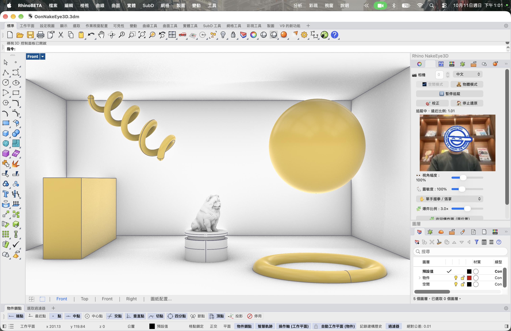
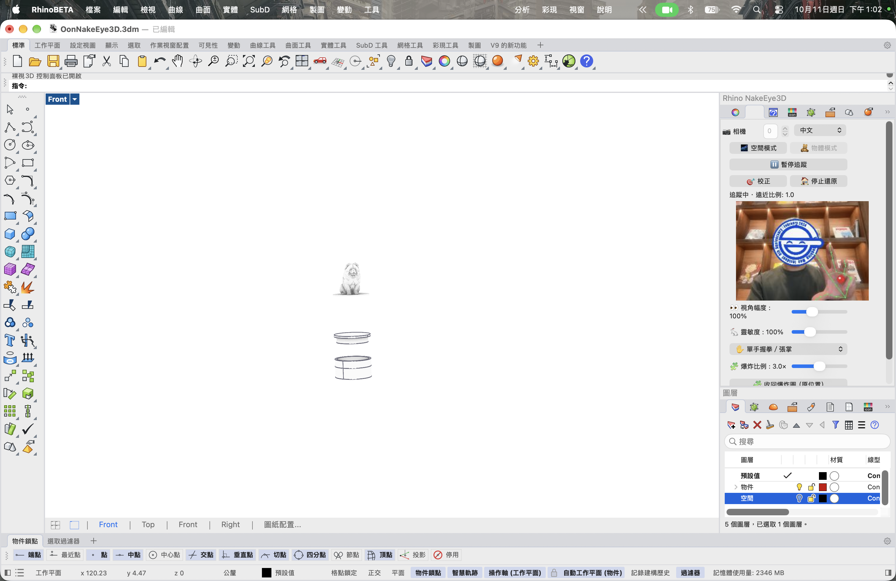

# Rhino ViewMotion

[中文](README.md) · [English](README.en.md)

透過 webcam 頭部與手勢追蹤，提供單人觀看的互動視差 3D。追蹤觀看者的位置來調整攝影機；不追蹤眼球注視方向，也不向左右眼分別輸出立體影像。

**這是功能尚不完善的測試版，仍有已知問題。請使用模型副本測試。** 笑面男圖片僅供向《攻殼機動隊》致敬與功能測試，之後會更換；權利屬原權利人。

## 功能

- 空間模式：頭部左右、上下與遠近控制視角。
- 物體模式：拇指、食指與中指抓握，環繞物件旋轉攝影機；移動手掌遠近可拉近／拉遠。抓握期間暫停頭部控制。
- 爆炸圖：可選雙手食指，或單手握拳／張掌；比例可調，張掌回握拳與失去手部時平滑收合。至少需要兩個獨立零件。自動取景依視窗比例計算，保留少量邊緣空間。
- 原生 Rhino 面板、開始／暫停共用按鈕、中英日介面、使用說明、幅度與靈敏度滑桿。
- 本機 webcam 預覽、動畫臉部遮罩、手部骨架與抓握狀態球。
- 使用目前文件與透視視窗，開始時記錄攝影機基準，停止時還原；不自動開啟測試模型。
- 全螢幕使用 Rhino `Fullscreen`，Esc 返回；Mac Rhino 8 不支援此指令。

## 安裝

如果曾安裝舊品牌的 Yak，請先在 PackageManager 移除舊套件，再安裝新版；外掛識別碼沿用，避免同時安裝。Mac webcam 啟動器目前為 Apple Silicon 版本。

1. 從 [Releases](https://github.com/ZionW/Rhino-ViewMotion/releases) 下載對應版本的 Yak：Rhino 8.35+ 或 Rhino 9。
2. Rhino 執行 `PackageManager`，選「從檔案安裝」，安裝後重新啟動。
3. 第一次啟用 webcam 前，使用 Python 3.11 執行安裝資料夾內的 `tools/setup_yak_runtime.py`。Windows：`py -3.11 tools/setup_yak_runtime.py`；Mac：`python3.11 tools/setup_yak_runtime.py`。需要網路下載追蹤依賴。
4. 執行 **`ViewMotionPanel`**，選擇透視視窗並開始追蹤。Mac 相機權限提示時允許 ViewMotion Webcam。
5. 側欄面板標籤按右鍵，在面板清單勾選 **Rhino ViewMotion**，可將面板放入目前容器。

Rhino 9 macOS 已測試側邊停駐、鏡頭預覽與頭部追蹤。Windows 尚未實機驗證；完整手勢、多文件切換及不同硬體的穩定性仍待測試。距離僅為 webcam 估算，實體螢幕校正尚未完善。

## 測試畫面

以下為改名前的 Rhino 9 測試截圖，介面名稱尚顯示舊品牌。





## 開發與驗證

`TrackingPanel.py` 管理面板，`ViewportTracking.py` 控制攝影機，`ExplodedView.py` 管理零件位置，`webcam_tracker.py` 處理本機追蹤。Rhino 8 使用 net7.0；目前 Rhino 9 Beta 使用 net10.0，兩者分別編譯。

```sh
python3 -m unittest discover -s tools -p 'test_hand_gestures.py'
python3 tools/build_yak.py
```

建置需要 .NET SDK、已安裝 Rhino 8／9 與 MediaPipe 模型。`tools/build_yak.py --skip-build` 可使用已編譯的 Release 檔打包；兩個 Yak 均會做完整性與 Python 語法檢查。[測試流程](TEST_GUIDE.md)

## 資料與資產

追蹤服務僅綁定本機。預覽單張影像暫存於 `runtime/preview.jpg`，持續覆寫，正常停止後移除；程式不錄影或上傳。GIF 遮罩不是匿名化保證。runtime、虛擬環境、模型快取與封存套件不納入版本控制。MediaPipe 模型與笑面男資產的權利仍屬各自權利人。
